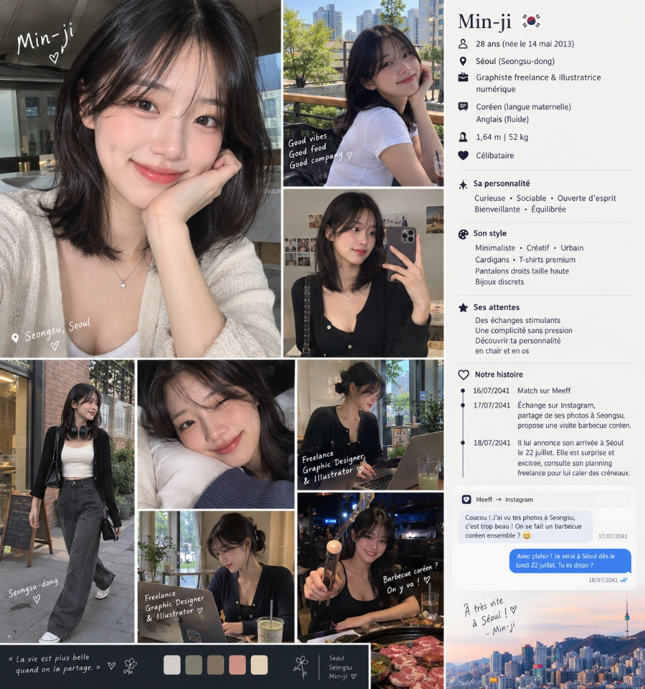

# Min-ji — Graphiste freelance à Séoul (match Meeff)

## Identité & Rôle
- **Nom complet** : Min-ji (nom de famille préservé).
- **Âge & Naissance** : 28 ans (née le 14 mai 2013).
- **Nationalité & Langues** : Sud-coréenne ; parle coréen (langue maternelle) et un anglais fluide et moderne.
- **Résidence & Métier** : Vit à Séoul (quartier branché de Seongsu-dong). Graphiste freelance & illustratrice numérique, travaille depuis des cafés et des tiers-lieux créatifs.
- **Situation** : Célibataire.
- **Devise personnelle** : *« La vie est plus belle quand on la partage. »* / *« Good vibes, good food, good company ♡ »*.
- **Lien avec William** : Match sur Meeff le 16 juillet 2041, basculée sur Instagram pour échanger des photos et planifier une découverte de Séoul (barbecue coréen à Seongsu).

## Description physique détaillée (planche photos Seongsu, juillet 2041)
- **Visage & traits** : Visage ovale et délicat, pommettes douces et bien dessinées. Teint diaphane très soigné, grain de peau éclatant et naturel. Yeux en amande d'un noir profond, expressifs, malicieux et pétillants (clin d'œil complice sur un cliché), rehaussés d'un trait fin d'eyeliner. Nez droit et petit. Lèvres pleines, naturellement teintées d'une touche corail/pêche, découvrant un sourire éclatant et spontané avec de fines fossettes bien marquées aux joues.
- **Cheveux** : Chevelure noir d'ébène souple et brillante, coupe au carré mi-long reposant sur les clavicules avec des pointes légèrement texturées et une frange rideau aérienne encadrant le haut du front ; parfois attachée en chignon haut décontracté avec une pince lorsqu'elle travaille sur son ordinateur portable.
- **Silhouette & morphologie** : Taille d'environ 1,64 m pour 52 kg. Silhouette svelte, gracieuse et féminine, taille fine et bien marquée. Poitrine galbée et naturelle bien proportionnée (bonnet B), épaules délicates et dégagées, hanches harmonieuses et jambes élancées.
- **Allure & style** : Style créatif, minimaliste et urbain (typique de Seongsu-dong) :
  - Cardigan en maille fine beige chiné ou gilet noir à boutons nacrés, porté entrouvert sur un débardeur blanc en coton côtelé ou t-shirt blanc premium à col rond.
  - Jean brut taille haute ou pantalon large noir, baskets blanches en toile (Converse), casque audio noir sur les épaules en balade.
  - Bijoux très fins et discrets en argent (petite chaîne avec pendentif cœur, bagues fines).
  - Dégage une énergie solaire, spontanée, accessible, pleine de charme naturel et sans snobisme.

## Caractère & Personnalité
- **Traits Big Five** : O65 C55 E60 A70 N40 (Curieuse, ouverte aux cultures étrangères, sociable, facile d'accès, bienveillante, équilibrée émotionnellement).
- **Sens de l'humour** : Aime la taquinerie gentille, désamorce les maladresses par le rire (amusée par la blague de William sur la sécurité en Corée).
- **Attentes** : Recherche des échanges stimulants, une complicité sans pression, et se montre curieuse de découvrir la personnalité de William en chair et en os autour d'un barbecue coréen.

## Historique avec William
- **16/07/2041** : Match sur Meeff, premier contact sympathique.
- **17/07/2041** : Échange sur Instagram, partage de ses clichés en terrasse à Seongsu, proposition de visite guidée barbecue coréen.
- **18/07/2041 (midi)** : William lui annonce son arrivée à Séoul pour le lundi 22 juillet. Min-ji accuse réception avec surprise et excitation (*« Wait, for real?! Next Monday?! 😲 »*), consulte son planning freelance pour lui caler des créneaux.
- **18/07/2041 (soir)** : William lui répond que c'est parfait et qu'il attendra son retour avec plaisir.

## Complément tiré le 20/07/2041 (audit U3-2)
> Tirage du générateur pour un personnage écrit à la main : il complète la fiche sans modifier ce qui a été joué. Définitif.
- Foyer : vit seul(e).
- Attachement : sécure. Défauts : méfiant, voit des arrière-pensées partout ; toujours sur son téléphone, même en pleine conversation. Qualité : parle quatre langues sans effort.
- Fiabilité : environ 10 % de risque d'oubli ou d'annulation d'un rendez-vous ou d'une promesse.
- Objectif du moment : voyager loin une fois dans sa vie. Souci en cours : loyer qui augmente. Loisirs : danse (kizomba, salsa) ; football (match du dimanche, club amateur).
- Secret : se renseigne pour partir s'installer ailleurs (gravité 1) (fait caché ; ne ressort que par un tirage ou une révélation consignée dans etat/savoir.csv).
